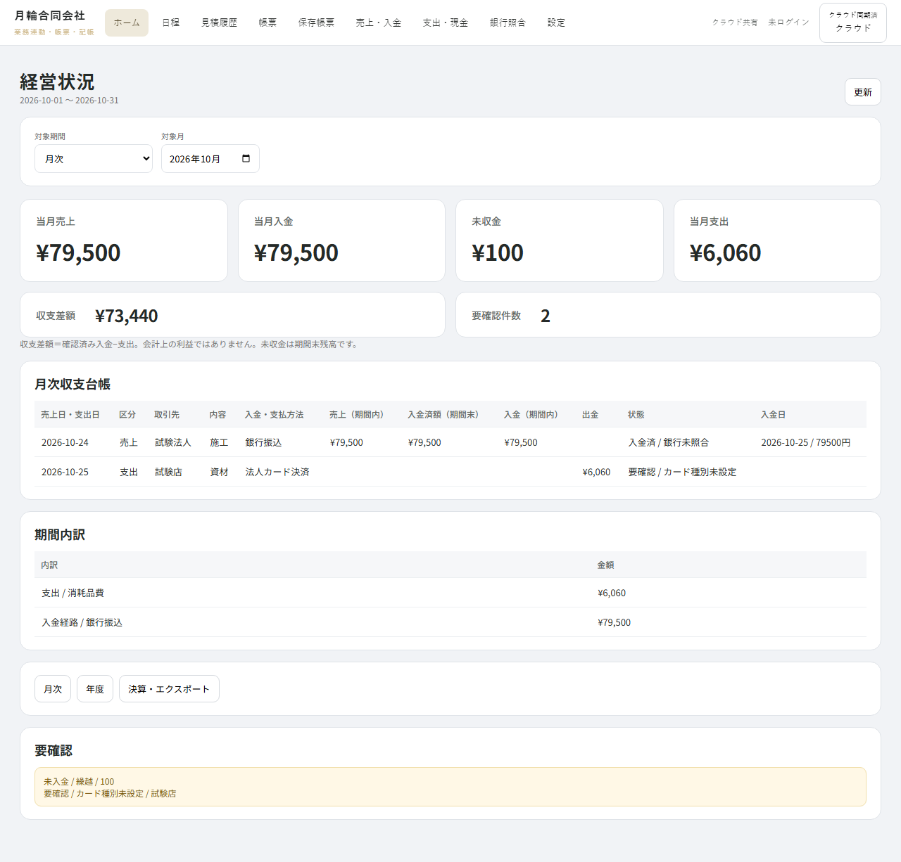
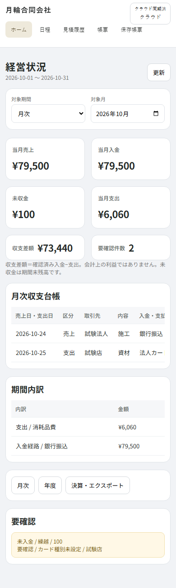
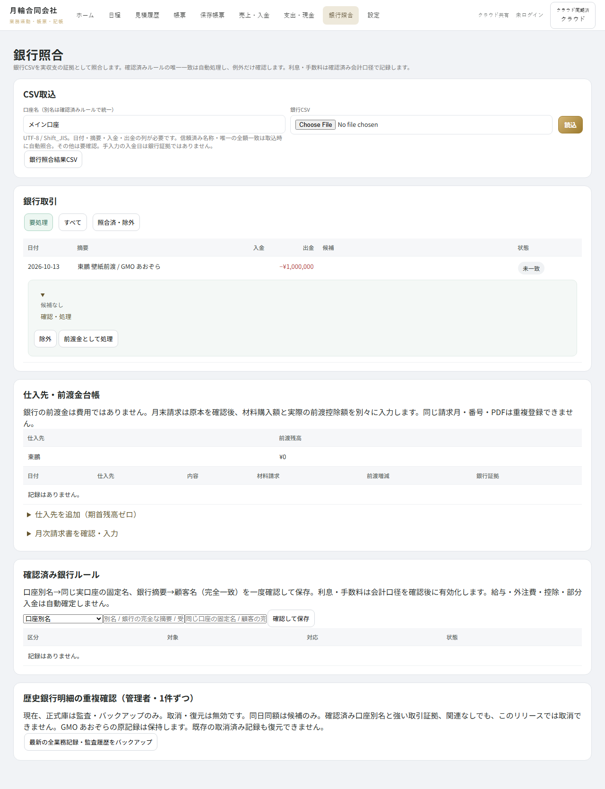
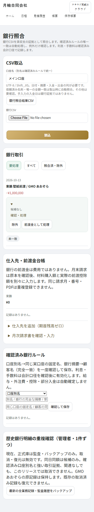

# HOME / 銀行照合 精修検証（2026-11-02）

## 基準と表示

作業前・push前に main `f7e443252857935dcacc5412a2dee697371cad70`、PR #20 head `5abdbd5f792e9310c231a9e4b85aa58a192b80d4` を確認。既存PRブランチに追加し、mainの履歴は変更しない。

確認済みのHOME・銀行照合の2画像を参照。白灰カード、白いナビゲーション、少量の金色、4主指標＋2補助指標、コンパクトなCSV・状態フィルタ、行全幅の照合パネルを実装。会社名は月輪合同会社。画像のWOOC・サンプル金額はアプリに追加していない。

HOMEの単一業務行と既存の財務列・期間内訳を保持したため、参考画像との完全なピクセル一致は目標にしていない。銀行の既存CSV・確認・仕入先・監査機能は保持。未実装の検索、再取得、OFX等を装飾目的で追加していない。

## 整理と書込み境界

- HOME/銀行用の後付けCSSと本文内の銀行CSSを、head内の単一 `homeBankStyles` に統合。重複する銀行幅・モバイル指定を削除。
- 候補の描画は既存 `bankMatch` の候補を再利用。候補再計算の別経路を除去。候補ゼロの空select・確定ボタンを表示しない。
- 東鵬の既知前渡金判定を既存ドメインから `accounting.js` へ移動し、UIとドメインで共用。判定条件は変更なし。拒否される支出補録入口を表示しない。
- 既存の `send → enqueue → domain` を維持。新しい保存経路・会計コマンド・コレクション・マイグレーションなし。
- KPI・sale/payment/receivable、支出・現金鏡像、銀行証拠、前渡残高、正式帳票/PDF、Calendar、CSV重複判定、オフラインキューの処理は変更なし。SWは既存のキャッシュ更新方式で版番号のみ更新。

CSSはレスポンシブ表示と全幅展開のため追加もある。総行数削減や大規模リファクタを行ったとは主張しない。

## 回帰と証跡

- `pnpm test`: PWA/静的検査と182単体テスト。追加: 2端末から同時に前渡金・月次請求を確定しても、銀行1件・費用1件・控除1回。
- `test:release:local`: 11ブラウザスイート。最終表示変更後、HOME、銀行証拠、前渡金、ナビゲーションを再実行。390px / 1280px。
- `test:release:emulator`: 8ブラウザスイート、実Firestoreルール。売上・入金・未収、現金、CSV再取込、跨月KPI、正式PDF読取時のゼロ書込み、Calendar、オフライン/競合を検証。
- `firestore-rules.cjs`: 43件。追加: 実エミュレータの2クライアントが同時確定しても前渡金・控除は一回、sales/payments/cashLedger/documents追加なし。
- ブラウザ追加検査: 4＋2カード構造、補助指標2列、月輪ブランド、展開前後のDB同一性、空確定入口なし、既知前渡金の費用入口なし、デスクトップ展開幅、水平ページ溢れなし。

スクリーンショットは隔離された**テストデータ**。本番残高の証明ではない。

| HOME desktop | HOME mobile |
|---|---|
|  |  |

| Bank desktop | Bank mobile |
|---|---|
|  |  |

同時競合時、敗者は既存Firestoreルールから permission-denied を受ける場合がある（業務の重複メッセージになるとは限らない）。再試行は業務層で重複拒否、部分書込み・再控除なしを検査。既存キュー・ルールを変えず、このメッセージ差は残す。

本番Firestore・歴史データ・清理済メイン口座31件にはアクセス/変更していない。元端末の4件キューは本作業で未検証のまま保持。PRはdraft維持、マージ・デプロイなし。GitHub CIはローカル結果と区別する。
