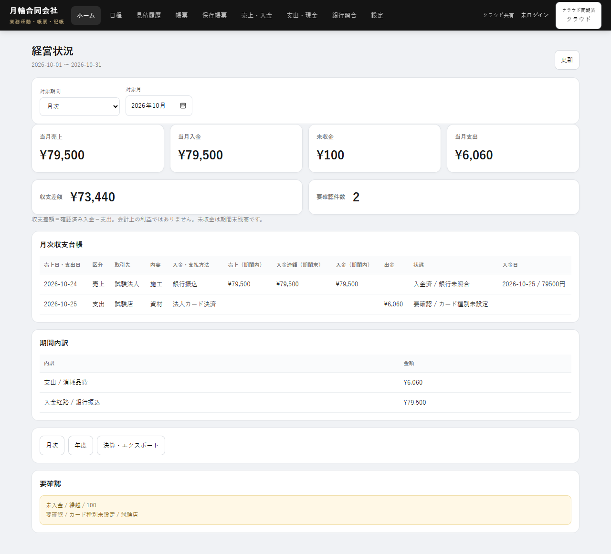
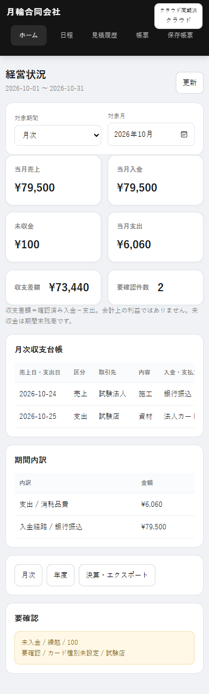
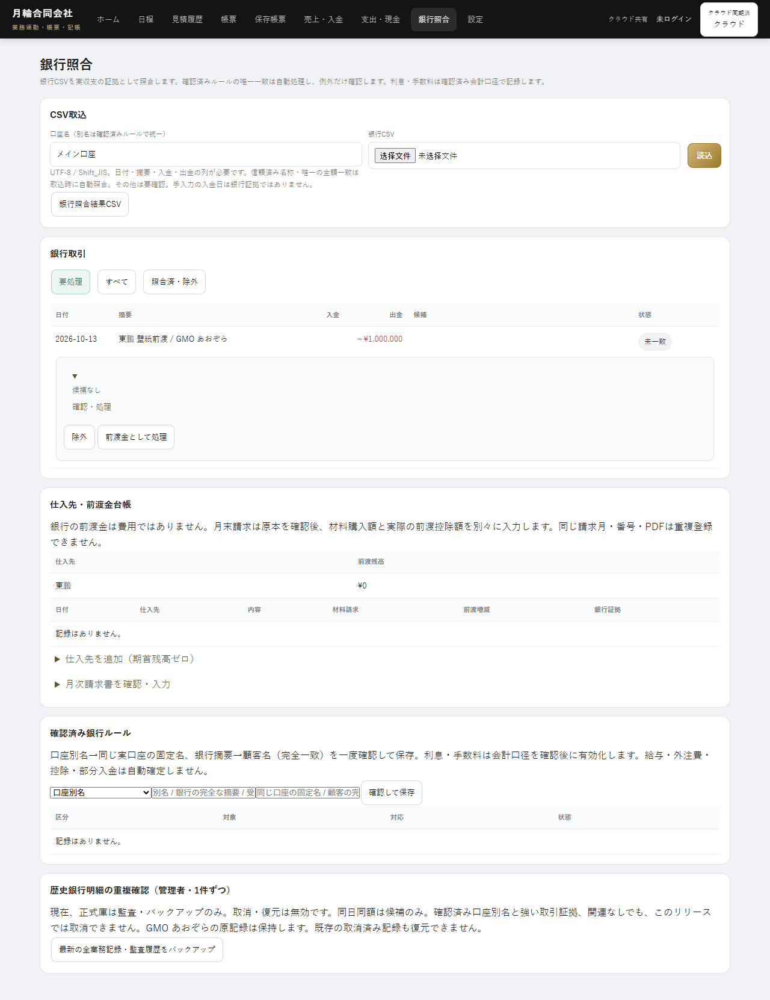
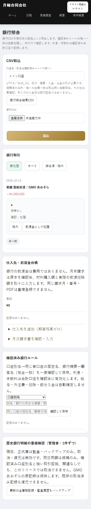

# HOME / 銀行照合 — 見積履歴 visual baseline

Based on main `6265733` and the user's final 見積履歴 screenshot (2026-11-02).

HOME and 銀行照合 now inherit the existing shared theme: black navigation, gold brand accent, dark selected menu, #f0f2f5 page background, white rounded sections, fine grey borders, Japanese font stack, compact tables and ordinary / gold primary buttons. Removed conflicting page-specific typography, widths, spacing and white-navigation overrides. KPI values use the existing shared responsive sizes (25px desktop / 20px narrow mobile).

Kept the complete ledger columns with horizontal scrolling, all six KPIs, period selectors, CSV exports, candidate selection and expandable bank controls, supplier prepayments, invoice review and bank-rule controls. No application markup, inline JavaScript, accounting modules, database settings or Firestore rules changed. Production was not accessed by the tests.

The shared mobile navigation now has five columns for its five existing visible items; this prevents 保存帳票 spilling below the black bar without changing route visibility. The bank CSV grid uses zero minimum track sizes so long controls stay contained.

## Verification

- 182 unit tests and static / service-worker checks passed.
- HOME and supplier-prepayment browser suites passed at 320, 390, 768, 1280 and 1920px, with isolated in-memory records and disabled production Firebase configuration.
- Shared-theme assertions compare computed page, title, section, heading, table and button styles directly against 見積履歴. They check black navigation, dark selection, grey background, navigation containment, unobscured headings, no page overflow and zero record changes during inspection.
- HOME regression covers month / fiscal year / custom periods, six KPIs, complete ledger fields, installment statuses and BOM CSV exports.
- Bank regression covers candidate expansion, status filters, prepayment registration, reviewed PDF invoice / actual deduction, no duplicate expense / outflow, interest and cashback.
- Login persistence passed for admin and staff across reload, browser restart, installed PWA reopening and explicit logout.
- Other local browser suites passed: Onoda documents, navigation / roles / PWA upgrade, calendar sync, cloud dialog, receipt-calendar, business workflow, estimate-calendar and bank evidence.
- GitHub release checks run the project's locked Chromium and Firestore-emulator suites on the PR. Their status is reported separately; no merge or deployment is authorized by this PR.

## Screenshots (isolated fixtures)

| HOME desktop | HOME mobile |
| --- | --- |
|  |  |

| Bank desktop, expanded candidate | Bank mobile, expanded candidate |
| --- | --- |
|  |  |
