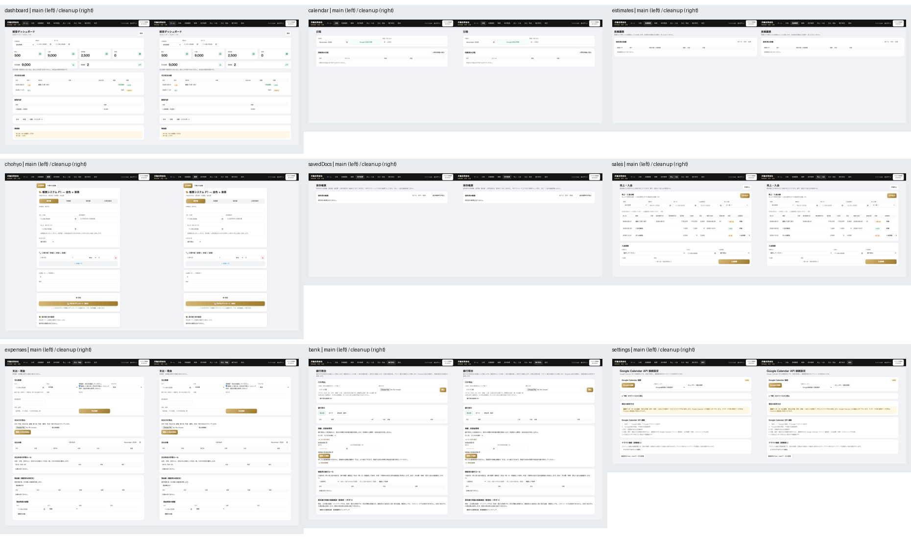
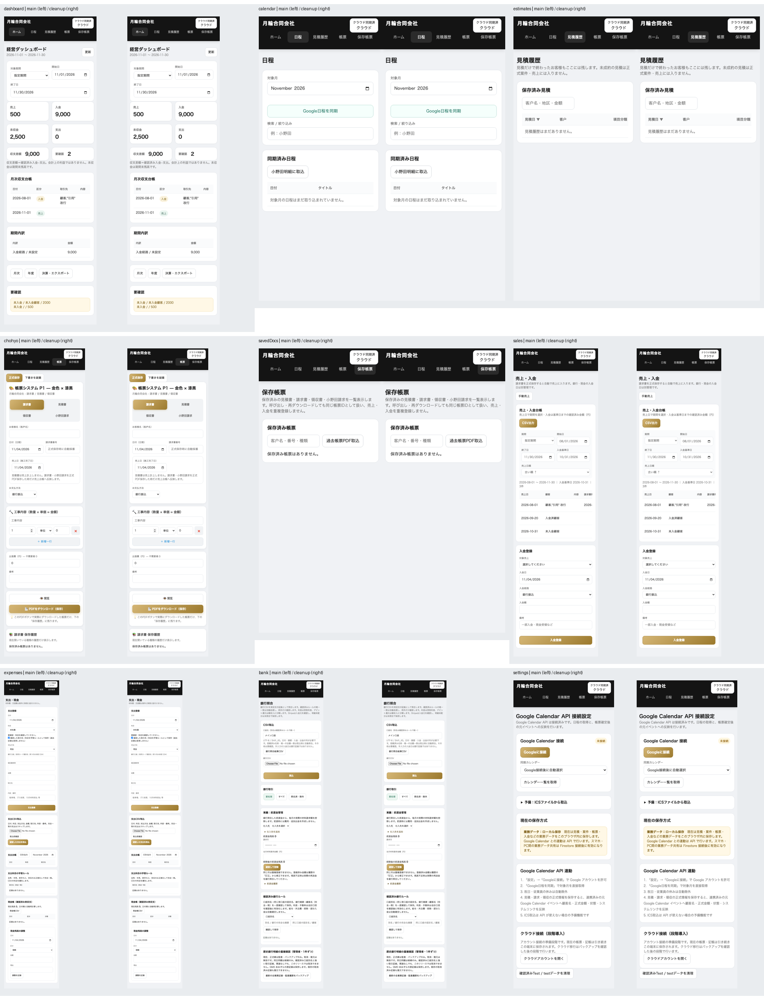
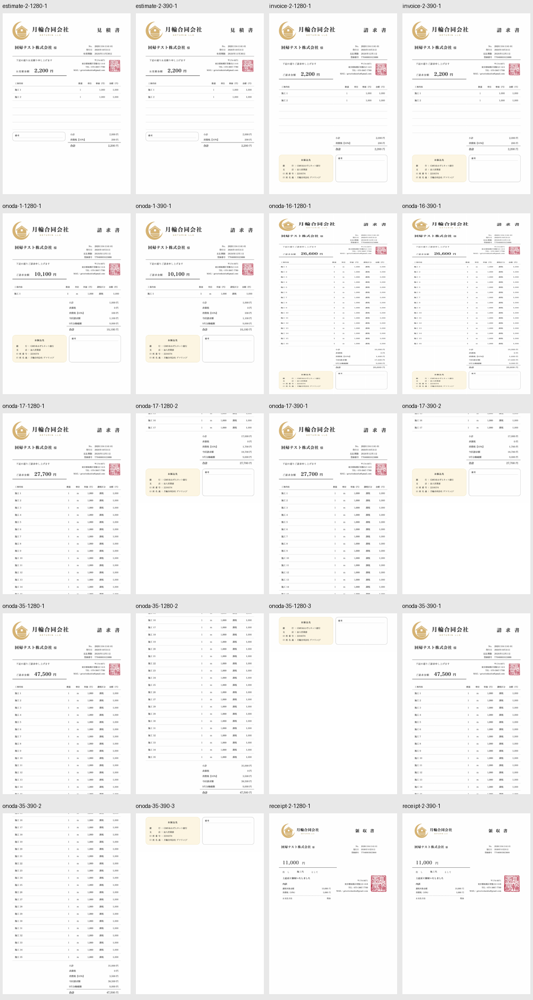

# 全站冗余代码清理：2026-11-04

以 `60cdcbfcb19aef91839f74656e033b047a2bfc60` 的 main 为基线。只清理能够证明无效或等价的代码；运行时代码仅修改 `index.html`，不格式化整文件。此 PR 供独立审查，不自动合并或部署。

## 并行 UI 开发核对

- PR [#29](https://github.com/sayonaraumi-tech/geruninn/pull/29)（全站样式）、[#30](https://github.com/sayonaraumi-tech/geruninn/pull/30)（見積履歴）、[#31](https://github.com/sayonaraumi-tech/geruninn/pull/31)（财务整合）均已合并，包含在上述 main。
- 开始时枚举了全部 32 个远端分支；其中部分旧分支通过 squash/cherry-pick 合并，不能仅凭 `main..branch` 尚有提交就判断有新 UI。最新远端提交仍为 main 的 2026-11-03 20:05:54（日本时间），没有发现晚于该基线的新 UI 提交。
- 仍有旧草稿 PR [#2](https://github.com/sayonaraumi-tech/geruninn/pull/2)，head 为 `04c8b216459abc1830b26cccb26c8216b295cf73`，创建/更新于 2026-10-05，涉及 Calendar、无效化和现金记账；本轮不合入、不关闭、不改写该分支。
- GitHub 无法检测另一台电脑未提交或未推送的 UI 修改。清理在 `codex/redundant-code-cleanup-20261104` 隔离分支完成。即使同文件改动很小，后续合并前仍应重新核对 main 与 UI 分支，解决冲突后复验视觉。

## 引用与级联分析

扫描 `index.html` 与全部 16 个直接应用 JS 文件中的函数声明、调用、内联 DOM 事件、动态模板、全局导出和捕获的原函数；另查测试及说明中的兼容用途。所有六个样式块共 465 条选择器规则按媒体条件检查，未修改第三方 PDF.js。

| 删除项 | 证明与保留内容 |
| --- | --- |
| `.invoice.onoda-mode.compact-1` 的 13 条规则 | 全站没有添加该类的路径；唯一运行时代码是从旧 DOM 清除类名。现在 16 行以内使用 `normal-16`，17 行以上使用 `multipage-onoda`。 |
| `.invoice.onoda-mode.compact-2` 的 17 条规则 | 同上；保留旧类名的清除操作，保留单页密度及多页逻辑。 |
| `.invoice.onoda-mode.compact-3` 的 17 条规则 | 同上。 |
| 较早的 `.invoice.receipt-mode .tadashi-block-classic { display:block }` | 相同媒体条件、相同选择器的后续规则无条件再次声明 `display:block` 并补充 margin/padding；后续完整规则原样保留。 |
| 800px 媒体块中较早的 `.biz-sync,.biz-user{display:none}` | 后续同一媒体条件、同一选择器已有 `display:none!important`，后者原样保留。 |
| 最早的旧 `renderCalendarEvents` 四列实现 | 同一个同步 script 中在任何初始化回调执行前就被后面的五列实现覆盖；没有捕获旧函数的引用。保留的新版函数体逐字一致，改为唯一函数声明。 |
| `purgeOldOnodaDrafts` 与三个内部调用 | 函数体为空，无返回值、无副作用、无导出/包装引用；删除这些空调用不删除任何旧月草稿。同步修正原注释中的“旧月削除”为“保持”。 |
| `bizDb`、`bizUnsub`、`bizRemoteApplying` | 除各自初始化之外没有任何引用；仅删除三个闲置变量，保留被回归用例观察的 `bizCloudReady`。 |

旧压缩规则的准确后代选择器：

- compact-1：`.hdr-classic`、`.greeting-info-block`、`.greeting-text`、`.amount-line`、`.items-classic`、`.items-classic thead th`、`.items-classic tbody td`、`.bottom-classic`、`.bank-card-classic`、`.bank-card-classic .bank-header`、`.remarks-card-classic`、`.totals-row`、`.totals-row.grand`。
- compact-2 / compact-3：各包含上述 13 项，再加 `.amount-value-classic`、`.contact-info-right`、`.seal-classic`、`.totals-classic`。

没有删除事件监听器。相同字段的 input/change 负责重算、草稿、同步等不同阶段，online/offline 与 visibility/pagehide 也有不同职责，不能仅按事件名相同合并。`bizSwitchPage`、`bizRefreshAll`、`bizOnDocumentConfirmed` 等捕获原函数的扩展链继续保留。

## 九页逐项结论

| 页面 | 审查结果 |
| --- | --- |
| HOME | 台账/KPI/期间导出与动态行状态仍被使用，不改展示逻辑。 |
| 日程 | 删除被覆盖的旧渲染器；保留新五列、详情入口、原标题、状态及 Google 关联。 |
| 見積履歴 | 排序、同日时间排序、单行操作组、宽表滚动和既有样式均保留。 |
| 帳票 | 删除 47 条不可达压缩样式和一条重复領収書声明；保留四类帳票、A4、密度、16/17 行边界、多页、carryover、印章及 PDF 链路。 |
| 保存帳票 | 保留本地和云端历史、原件回读、只读与重下载。 |
| 売上・入金 | 保留统一台账、基准日、期间、CSV、余额与收款表单；无安全删除项。 |
| 支出・現金 | 保留实际科目学习、支出 CSV、现金联动和本地回退；无安全删除项。 |
| 銀行照合 | 保留响应式行/详情/表单、实际候补、照合与前渡金逻辑；无安全删除项。 |
| 設定 | 保留备份、审计、权限与决算功能；无安全删除项。 |

## 必须保留的兼容逻辑

- `BIZ_KEY`、`BIZ_SETTINGS_KEY`、`CONFIRMED_HISTORY_KEY`、`SIMPLE_STATE_PREFIX`、旧月 onoda 草稿键、历史 localStorage 与旧字段默认值；归档 `__CHOHYO_EXPORTED_SNAPSHOT__` 回读及 dormant `downloadHtml` 仍保留，以免破坏已有保存版 HTML 工作流。
- cloud-core 的 `readLegacy`、未启用云端时的原函数回退、business-ui/accounting-ui 的 `original` 包装链、隐藏 recipient/supplier 字段、原件 snapshot 和修订关系。
- 历史 supplier/旧队列命令、blocked/retry/archive 语义、expectedRevision、operationId、事务、防重复、幂等、审计、权限及 Firestore Rules。
- 正式帳票/PDF、sales/payment/cashLedger 关系、银行证据、前渡金、支出学习、CSV、Google event ID/ETag/回写。

所有 JS 模块、Firestore Rules、配置、依赖/锁文件、SW 与业务数据格式均未修改。没有读取或写入生产 Firestore，没有迁移数据、删除或重放用户离线队列，没有写真实 Google Calendar。

## 代码规模（只计运行时代码）

按 UTF-8 原始字节与 LF 换行数计；代码文件未新增或删除。说明、测试、截图、第三方 vendor 与依赖不计入代码减量。

| 口径 | 清理前 | 清理后 | 减量 |
| --- | ---: | ---: | ---: |
| 修改的代码文件 | 1 | 1 | 0 |
| index.html 行数 | 3,703 | 3,520 | 183 |
| index.html 字节数 | 382,367 | 377,102 | 5,265（1.38%） |
| 第一方运行时文件数（index + sw + js/*.js） | 18 | 18 | 0 |
| 上述 18 文件行数 | 5,898 | 5,715 | 183 |
| 上述 18 文件字节数 | 714,043 | 708,778 | 5,265 |
| CSS 选择器规则 | 465 | 416 | 49 |

## 验证与证据

基线与清理版均通过 `pnpm test`（18 + 184 = 202 项）及全部 46 项 Firestore Rules 测试。最终版还通过：

- `pnpm test:release:local`：13 组浏览器套件。
- `pnpm test:release:emulator`：上述 46 项 Rules + 8 组真实模拟器业务浏览器套件。
- `git diff --check`。

关键业务操作实测包含：四类正式帳票保存/PDF适配链、原件重开/重下载零新增记账、局部/全额收款、真实 CSV 文件下载并逐单元格核对、两设备冲突与防重复、现金与支出、银行照合/取消、前渡金扣减、历史 PDF.js 提取、角色权限、审计、PWA 升级、离线队列恢复/重试和模拟 Google Calendar 的 POST/PATCH/ETag/去重。

额外视觉对照在 390px、1280px 使用相同合成数据：九页各一组；invoice/estimate/receipt 各 2 行，以及 onoda 1/16/17/35 行的 screen/print 媒体模式。比较全部可见元素的 tag/id/class、叶节点文字、位置尺寸和所有计算样式，等待 CSS 动画结束后比较截图。46/46 组可见 DOM、元素位置尺寸及全部计算样式完全一致；42/46 对截图逐像素一致，其余 4 对合计仅 56 个圆角容器边缘像素存在轻微色差（最大单通道差 5/255），未做遮罩。结合几何与样式不变，判断为栅格化差异；原始差异范围与计数保留。详细机器结果见 [visual-comparison.json](cleanup-2026-11-04/visual-comparison.json)。

测试环境：Node 24.22.1、Playwright 1.62.1 / Chromium、Java 21、本机 `demo-tsukinowa` Firestore 模拟器；Google 请求由测试适配器处理。手机为视口模拟，未声称实机 Safari 验证。现有业务套件中的 PDF 测试保留渲染适配器；另外加载 index.html 固定引用的真实 html2pdf.js 0.10.1（jsPDF 2.3.1），实际点击调用 doPrint 并捕获下载，在基线和清理版各生成 14 份合成 PDF。四类帳票覆盖 390/1280px，小野田覆盖 1/16/17/35 行。每版共 20 页，全部为 A4；各文件页数和逐页尺寸一致，Poppler 72 DPI 渲染的 20/20 页像素完全一致。1/16 行保持 1 页、17 行 2 页、35 行 3 页。参见 [PDF 机器比较结果](cleanup-2026-11-04/pdf-comparison.json) 和下方全部导出页预览。未声称实机 Safari/系统打印机或生产服务验证。测试没有对生产数据做任何探针写入。

